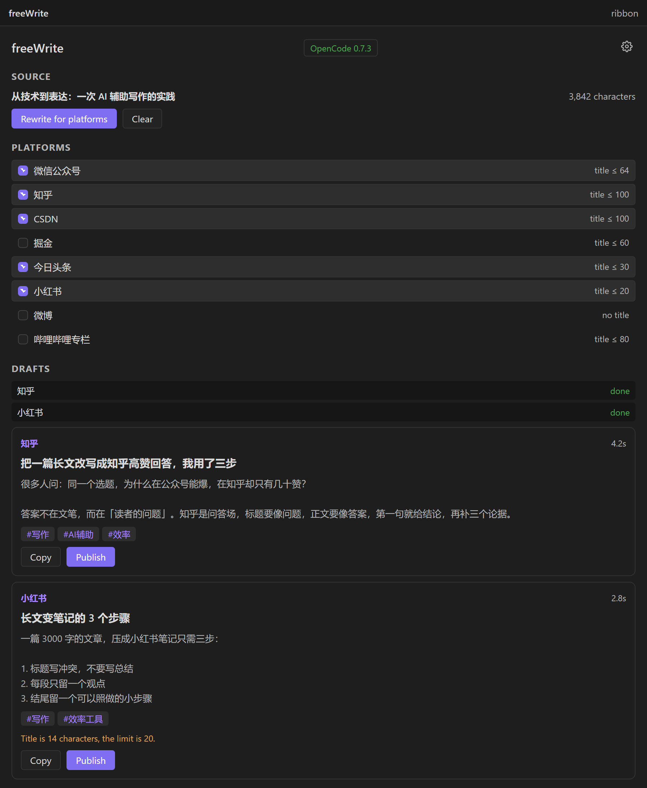
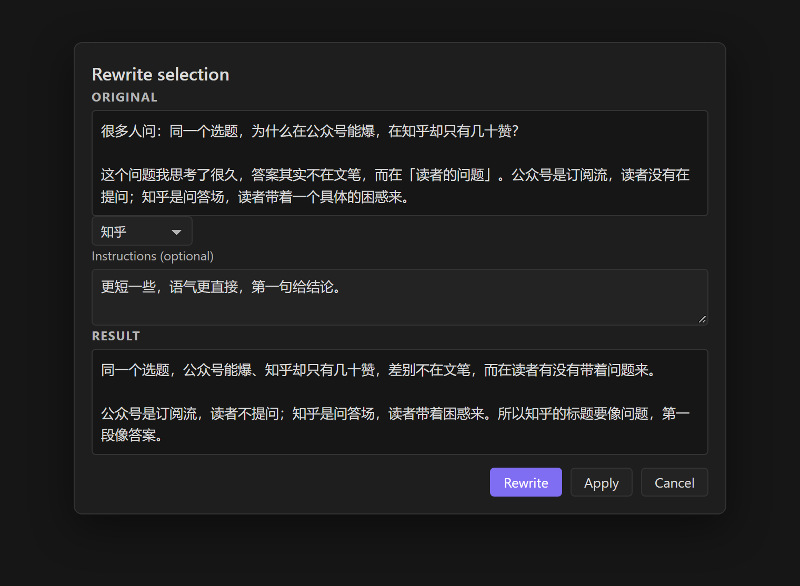
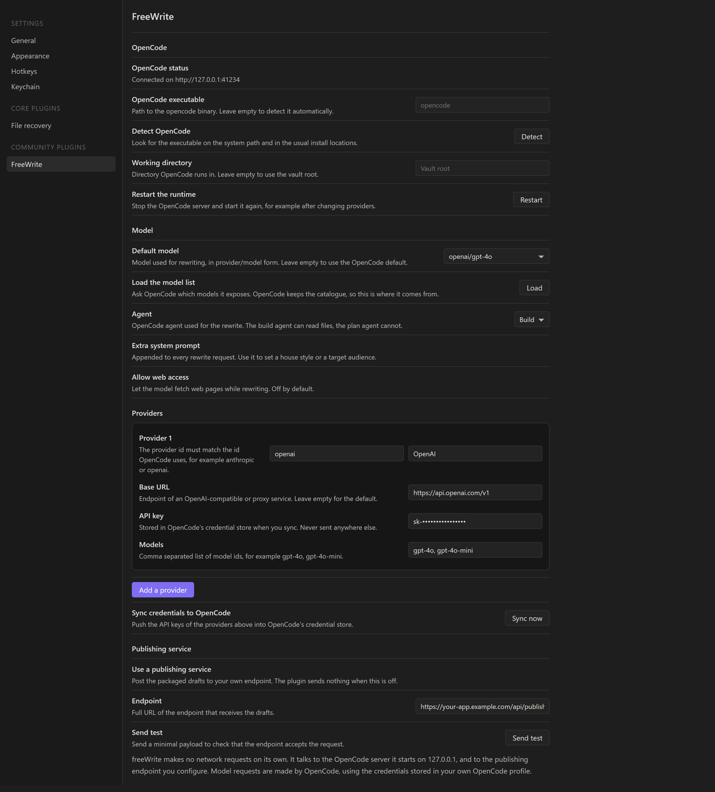

# freeWrite

Turn one note into ready-to-publish drafts for a dozen platforms, using a
local [OpenCode](https://opencode.ai) runtime that you control.

freeWrite runs entirely on your machine. It asks the model you configured to
rewrite your article for each target platform, checks the result against that
platform's limits, and hands you a finished draft. You decide when and where
it goes.

## What it does



**One note, many platforms.** Pick a note, choose the platforms, and freeWrite
produces a separate draft for each one: a title that fits the platform's
character limit, a body written in that platform's register, and the right
topic tags. A long technical article becomes a 280-character Weibo post, a
20-character Xiaohongshu title and a full CSDN tutorial without you rewriting
anything by hand.

**Inline rewriting.** Select a paragraph, run `FreeWrite: Rewrite the
selection`, and review the proposed replacement before it touches your note.



**Two publishing channels.** The default puts the draft on your clipboard and
opens the platform's own compose page, so you publish from a session you are
already signed in to. If you run your own publishing service, point freeWrite
at it and it posts the packaged drafts to your endpoint instead, on demand or
on a schedule.

**Your models, your credentials.** freeWrite does not have a model of its own
and does not call any provider. It writes your provider configuration into
OpenCode and lets OpenCode handle authentication and requests, exactly the way
the OpenCode CLI does.

## Requirements

- Obsidian 1.5.0 or later, on desktop.
- [OpenCode](https://opencode.ai) installed separately. freeWrite never
  installs or updates it.

OpenCode is started by freeWrite as a local server on `127.0.0.1`. Nothing
listens on a public interface.

## Installation

### Manual

1. Download `main.js`, `manifest.json` and `styles.css` from the latest
   [release](https://github.com/fenghaiju/freewrite/releases).
2. Create the folder `<your-vault>/.obsidian/plugins/freewrite/`.
3. Copy the three files into it.
4. Restart Obsidian, then enable **FreeWrite** under
   *Settings → Community plugins*.

### With BRAT

Install the [BRAT](https://github.com/Trikkon/obsidian-brat) plugin, then run
`BRAT: Add a beta plugin` and enter `fenghaiju/freewrite`.

## Getting started

1. Open a note you want to publish.
2. Run `FreeWrite: Rewrite the current note for platforms`, or click the
   pencil icon in the ribbon to open the workbench.
3. Tick the platforms you want.
4. Press **Rewrite for platforms**.
5. Review the drafts, fix anything you like, and press **Publish** on each one.

The first rewrite starts the OpenCode server, which takes a few seconds.

## Configuring a model



freeWrite uses the model you selected in **Settings → FreeWrite → Model**. The
default is whatever OpenCode itself would pick.

OpenCode owns the model catalogue, so freeWrite does not keep its own copy of
it. Press **Load the model list** to ask OpenCode which models it exposes; the
**Default model** field then becomes a dropdown of `provider/model` entries.

For a provider OpenCode does not know yet, add it under **Providers**:

| Field | Meaning |
| --- | --- |
| Provider id | The id OpenCode uses, for example `anthropic` or `openai` |
| Display name | A label for the settings UI |
| Base URL | The endpoint of an OpenAI-compatible or proxy service |
| AI SDK package | For custom endpoints, for example `@ai-sdk/openai-compatible` |
| API key | Stored in OpenCode's credential store when you sync |
| Models | Comma separated model ids |

Press **Sync credentials to OpenCode** afterwards. The keys are written into
OpenCode's own auth store, not sent anywhere else.

If you already use OpenCode with a provider, you do not need to configure
anything here: freeWrite inherits your global and project OpenCode
configuration.

## Publishing channels

### Clipboard (default)

Pressing **Publish** copies the finished draft to your clipboard and opens the
platform's compose page in your browser. You paste and press publish. The
plugin never holds a platform credential and never posts to a platform on your
behalf.

### Your publishing service

If you already run a service that publishes to these platforms, freeWrite can
hand it the work instead.

Enable **Use a publishing service** and set the endpoint. The plugin then
sends one JSON document per publish:

```json
{
  "schema": "freewrite/bridge@1",
  "taskId": "fw_m1x2y3_ab12cd34",
  "createdAt": "2026-10-30T08:15:00.000Z",
  "source": {
    "vaultName": "My Vault",
    "vaultPath": "/home/me/My Vault",
    "notePath": "posts/2026/hello.md",
    "noteTitle": "hello",
    "raw": "the original note body"
  },
  "targets": [
    {
      "platformId": "zhihu",
      "platformName": "知乎",
      "title": "标题",
      "body": "正文",
      "tags": ["效率", "写作"],
      "summary": "一句话摘要",
      "publishUrl": "https://zhuanlan.zhihu.com/write",
      "images": [
        {
          "name": "cover.png",
          "vaultPath": "assets/cover.png",
          "absolutePath": "/home/me/My Vault/assets/cover.png",
          "mimeType": "image/png",
          "bytes": 204800
        }
      ]
    }
  ],
  "options": {
    "publish": true,
    "scheduleAt": null
  }
}
```

Your service decides what to do with it. The `schema` field is versioned, so
your service can detect a format change. `options.publish` is `true` when the
user pressed publish, and `options.scheduleAt` carries an ISO timestamp when
the drafts should be scheduled rather than sent immediately.

The request carries an `Authorization` header when you set a token, plus any
extra headers you configure. Use **Send test** in the settings to check that
the endpoint accepts the request before relying on it.

## Supported platforms

| Platform | Title | Body | Tags | Markdown |
| --- | --- | --- | --- | --- |
| 微信公众号 | 64 | 800–2500 | no | no |
| 知乎 | 100 | 1000–4000 | 5 | yes |
| CSDN | 100 | 1200–5000 | 5 | yes |
| 掘金 | 60 | 1000–4000 | 3 | yes |
| 今日头条 | 30 | 600–2000 | 5 | no |
| 哔哩哔哩专栏 | 80 | 1200–4000 | 10 | yes |
| 小红书 | 20 | 300–1000 | 10 | no |
| 微博 | — | 80–280 | 3 | no |
| X | — | 80–280 | 2 | no |
| 简书 | 80 | 800–3000 | no | no |
| DEV Community | 120 | 600–3000 | 4 | yes |
| Medium | 100 | 600–2500 | no | yes |

Lengths are counted the way the platforms count them: a Chinese character
counts as two, so the numbers match the real limits rather than the character
count you would see in an editor. When a draft misses its target, the
workbench shows a warning next to it. The warning is advisory; you can always
edit the draft before publishing.

## Privacy

freeWrite makes no network requests of its own. It talks to the OpenCode
server it starts on `127.0.0.1`, and to the publishing endpoint you configure.
Model requests are made by OpenCode, not by the plugin.

The full details are in [PRIVACY.md](PRIVACY.md).

## Development

```bash
npm install
npm run dev        # watch build
npm test           # unit tests
npm run lint       # eslint, including the Obsidian plugin rules
npm run build      # type check and production build
npm run check      # everything above
```

Copy `main.js`, `manifest.json` and `styles.css` into
`<your-vault>/.obsidian/plugins/freewrite/` to try a build, or symlink that
folder to the repository.

The project is written in TypeScript and bundled with esbuild. The Obsidian
API is the only runtime dependency.

## Licence

MIT. See [LICENSE](LICENSE).
